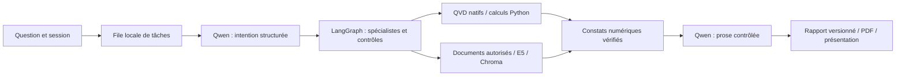

# ONMT AI

Projet personnel de pilotage touristique conversationnel : explorer des fichiers QVD natifs, calculer des indicateurs, consulter une bibliothèque documentaire et produire des rapports sourcés avec des modèles exécutés localement.

Les données de référence sont **entièrement synthétiques**. Elles servent à vérifier un logiciel ; elles ne décrivent aucune observation officielle de l’ONMT. Les calculs, l’OCR, les embeddings, l’inférence et les exports du mode normal sont réellement exécutés.

## Fonctionnalités

- Conversation en français, anglais, espagnol, arabe et darija en écriture arabe, avec contexte persistant, clarifications et traces des tâches.
- Catalogue de **46 KPI distincts**, formules et unités explicites, comparaisons, contrôles de qualité et projections mensuelles. Les horizons longs sont des scénarios mécaniques signalés comme tels.
- Proposition d’un KPI par conversation : champs autorisés, formule structurée, exemple, confirmation explicite, auteur et versions persistantes. Aucun code produit par le modèle n’est exécuté.
- BCG concurrentielle, BCG des douze régions, Valeur–Volume, aide Butler, benchmark international fictif sur treize indicateurs, scénarios et cartes ponctuelles.
- Graphiques interactifs : périodes, séries, info-bulles, navigation clavier et tableaux accessibles.
- Bibliothèque PDF persistante : extraction textuelle, OCR des scans, E5, ChromaDB, droits avant recherche, pages et versions des citations.
- Rédaction Qwen, quatre audiences, révisions, propositions liées aux constats, notes PDF structurées en quinze pages et présentations PDF de vingt-cinq diapositives.
- Comptes locaux, restrictions par module et territoire, documents privés, bibliothèque partagée explicite, tâches persistantes avec étapes et annulation coopérative.
- Vérifications périodiques locales des sources et alertes, audit avec chaîne d’empreintes vérifiable.

La compréhension libre, la profondeur rédactionnelle et la qualité linguistique restent à évaluer au-delà des cas testés. **Arabe et darija : brouillons à relire**, sans validation humaine de publication. Le [bilan](docs/full-app/14-validation-completion.md) distingue les tests simulés des essais réels et la [matrice CPS](docs/full-app/01-couverture-cps.md) conserve les écarts.

## Architecture et pipeline



Le planificateur interprète ; les spécialistes prennent des décisions bornées et utilisent des outils autorisés. Python calcule les chiffres. Le modèle rédige à partir de preuves sélectionnées ; le serveur insère les nombres et citations exacts. Les traces montrent les tâches, outils et sources utilisés.

SQLite conserve l’état applicatif, les versions documentaires et les PDF. Les tables métier restent dans les QVD. Chroma conserve les vecteurs et passages indexés. Voir l’[architecture détaillée](docs/architecture.md).

## Technologies utilisées

Python 3.11, FastAPI, Pydantic, HTTPX, PyQvd, LangGraph, SQLite, Sentence Transformers, PyTorch CPU, E5 multilingual-small, ChromaDB, pdfplumber, PDFium, Tesseract, Qwen2.5 3B via Ollama, Jinja2, Chromium/Playwright, React, TypeScript et Vite. Les graphiques utilisent SVG ; aucune carte ni police distante n’est chargée.

Le **SDK Python Ollama est supprimé** : HTTPX appelle directement le service local. Le **service Ollama** exécute l’inférence ; les **poids GGUF Qwen** sont les paramètres du modèle. Ces trois éléments sont distincts. Un service arrêté, un modèle absent ou une génération refusée produit une erreur explicite.

`backend/requirements.txt` est l’unique point d’entrée Python. Le [relevé de versions](backend/requirements-tested.lock.txt) documente la résolution Windows validée, avec ses dépendances transitives. PostgreSQL, psycopg, SQLAlchemy, Alembic, pandas et statsmodels ne sont pas requis par cette implémentation. Scikit-learn et NumPy restent notamment des dépendances des bibliothèques de modèles.

## Données et conventions

La référence conserve ses trois QVD : Finance, Commercial et Performance, **6 300 lignes**, de janvier 2021 à octobre 2026, six destinations et cinq marchés. Les compléments ajoutent des conversions, de l’événementiel, des grandeurs macroéconomiques fictives, des piliers de compétitivité et des comparateurs.

Les noms et coordonnées géographiques sont réels et sourcés ; les indicateurs sont fictifs. Les comparateurs monétaires sont générés directement en MAD de scénario : aucune conversion de devises implicite. Les définitions pédagogiques et les adaptations du TTCI 2019 ne constituent pas une homologation internationale.

Les [règles de données](docs/full-app/03-donnees.md) et le [catalogue détaillé](docs/full-app/12-catalogue-et-conventions.md) décrivent les unités, grains, relations, scénarios et attendus indépendants. Une configuration `ONMT_QVD_ROOT` / `ONMT_SOURCES_CONFIG` permet d’utiliser d’autres QVD ultérieurement ; elle est facultative.

## Prérequis

Environnement validé : Windows x64, Python 3.11, Node.js 22 et PowerShell. Le poste de test possède 16 Go de RAM et un Intel i7-7600U à deux cœurs/quatre threads. L’inférence est sur CPU. Prévoir environ 15 à 20 Go disponibles pour les environnements, téléchargements, poids et copies d’import ; le script contrôle une marge minimale de 10 Gio.

Une connexion Internet est nécessaire à la première installation des paquets, outils et modèles. Leur exécution normale utilise les fichiers locaux. Les licences des modèles et outils restent applicables ; Qwen2.5 3B emploie la licence Qwen Research fournie avec ses poids.

## Première installation

Depuis la racine du dépôt :

```powershell
.\scripts\setup-local.ps1 -DownloadModelsAndTools -PrepareLibrary
```

Ce script crée la venv si nécessaire, installe les dépendances Python, Chromium et le frontend, prépare les poids/outils demandés, génère les QVD s’ils sont absents, puis les compléments et la bibliothèque. Il conserve les QVD de référence déjà présents et les imports privés. La préparation de la bibliothèque est idempotente et publie uniquement son corpus synthétique réservé.

Les téléchargements de modèles et de Tesseract sont séparés des requirements. Pour les lancer individuellement :

```powershell
.\.venv\Scripts\python.exe scripts\prepare-local-ai.py --components ollama ocr embeddings llm
$env:PLAYWRIGHT_BROWSERS_PATH = "$PWD\local_data\browsers"
.\.venv\Scripts\python.exe -m playwright install chromium
```

Démarrer ensuite Ollama dans le terminal 1, puis importer Qwen **une seule fois** dans un autre terminal :

```powershell
.\local_data\tools\ollama\ollama.exe create onmt-qwen25:3b -f local_data\models\qwen25-3b-gguf\Modelfile
```

Pour préparer uniquement les données ou réindexer le corpus après installation :

```powershell
$env:PYTHONPATH = "$PWD\backend"
# Uniquement si les trois QVD de référence n’existent pas encore :
.\.venv\Scripts\python.exe -m app.data_access.synthetic
.\.venv\Scripts\python.exe -m app.data_access.supplement
.\.venv\Scripts\python.exe -m app.reports.library --confirm-shared-library
```

La génération de données crée des fichiers fictifs. L’installation copie des logiciels et des poids. L’indexation calcule et conserve des embeddings. L’inférence utilise les poids existants. **L’indexation n’est pas un entraînement ; aucun fine-tuning n’est réalisé.**

## Démarrages suivants : trois terminaux

Terminal 1 :

```powershell
.\scripts\start-local-ollama.ps1
```

Terminal 2 :

```powershell
.\scripts\start-full-app.ps1
```

Terminal 3 :

```powershell
cd frontend
npm run dev
```

Interface : [http://127.0.0.1:5173](http://127.0.0.1:5173). Documentation API : [http://127.0.0.1:8000/docs](http://127.0.0.1:8000/docs).

Comptes de démonstration : `direction` et `regional`, mot de passe initial `OnmtLocal!2026`. Le second est limité à Agadir/Marrakech et ne dispose pas du module Finance. `ONMT_LOCAL_PASSWORD` permet de choisir le mot de passe avant la création initiale des comptes.

La surveillance et la file de tâches s’exécutent dans le processus API : aucun quatrième terminal n’est nécessaire. `ONMT_MONITOR_INTERVAL` règle l’intervalle, 60 secondes par défaut dans le script, 0 pour désactiver. Ctrl+C arrête chaque service. Une annulation de tâche attend la prochaine étape ; une inférence déjà commencée peut aller jusqu’à son délai maximal.

## Exemples de questions

1. « Compare les nuitées à Agadir en février 2025 et février 2024. » Attendu : 80 000 contre 100 000, soit −20 %.
2. « Et pour Marrakech ? » Attendu : 165 000 contre 150 000, soit +10 %.
3. « Montre le budget à Agadir en février 2025. »
4. « Fais une matrice Valeur–Volume pour Agadir en février 2025. »
5. « Compare les destinations internationales en février 2025 et février 2024. »
6. « Crée un KPI part des nuitées France : nuitées France divisées par toutes les nuitées, fois cent, à Agadir en février 2025. » Vérifier le brouillon et son exemple, puis confirmer explicitement.
7. « Prépare une note structurée pour la direction. »
8. « Traduis la synthèse en arabe. »
9. « Prépare la présentation de vingt-cinq diapositives. »

Une formulation ambiguë demande une précision. Le panneau Diagnostics permet aussi de régler explicitement les périodes et seuils. Un [parcours complet expliqué](docs/full-app/13-fichiers-et-pipeline.md) relie question, calculs, documents, rapport et présentation.

## Tests et évaluation

```powershell
.\.venv\Scripts\python.exe -m pytest -q -m "not local_ai and not models and not full_models and not browser"
Push-Location frontend
npm test
npm run build
Pop-Location
```

Essais réels supplémentaires, avec modèles/outils préparés :

```powershell
$env:PYTHONPATH = "$PWD\backend"
$env:ONMT_TEST_COMPLETION_REAL = '1'
.\.venv\Scripts\python.exe -m pytest backend\tests\test_cps_real.py -q --basetemp=local_data/cps-completion-results/pytest-real
$env:ONMT_TEST_PRESENTATION = '1'
.\.venv\Scripts\python.exe -m pytest backend\tests\test_presentations.py -q
.\.venv\Scripts\python.exe scripts\evaluate-cps-languages.py
.\.venv\Scripts\python.exe scripts\measure-local.py --repetitions 3
# Appels réels, sans autre client d'inférence en parallèle :
.\.venv\Scripts\python.exe scripts\measure-models.py
```

Les oracles de calcul sont écrits indépendamment du moteur. Les tests ordinaires utilisent des interpréteurs simulés pour certains parcours ; les essais E5/OCR/Ollama sont explicitement identifiés. Les jeux linguistiques de développement et d’évaluation sont séparés et versionnés. Voir le [bilan daté avec commandes, commits et environnement](docs/full-app/14-validation-completion.md).

## Performances et limites

Les mesures sont rapportées par étape, avec leur matériel, leur cache et leurs répétitions dans le bilan. Les rapports sur ce CPU peuvent demander plusieurs minutes. Une réussite isolée, les résultats historiques de novembre ou le temps d’un outil seul ne démontrent aucun SLA du CPS.

Sur le poste testé, le benchmark numérique prend environ 0,04–0,08 s. Une même interprétation Qwen prend 145 s après déchargement du modèle, puis 24–25 s à chaud ; la chaîne à quatre KPI et six sections, avec OCR/recherche/exports et révision arabe, a réussi en 489,82 s. Ces mesures ont des périmètres différents ; voir les répétitions et conditions dans le [bilan](docs/full-app/14-validation-completion.md).

Butler est une aide heuristique pouvant rester indéterminée. Les scénarios et projections longues ne sont pas des observations ni des effets économiques démontrés. La rédaction et les recommandations demandent une relecture ; aucune validation linguistique humaine générale n’est revendiquée.

L’application cible un poste local et un seul processus API. SSO d’entreprise, chiffrement industriel, stockage d’audit immuable externe, certification, charge à cinquante utilisateurs, voix et streaming de texte LLM restent des écarts de la cible industrielle ou des fonctions à compléter selon la matrice. Aucun déploiement cloud, Docker ou CI/CD n’est inclus.
