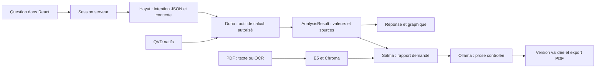

# De la question à la décision

Les responsables de l'ONMT disposent de données dans Qlik mais une question nouvelle peut demander une intervention BI. L'application propose une autre porte d'entrée : poser une question, vérifier un résultat et ses sources, puis rédiger une synthèse dans le même espace.

Imagine une petite équipe. Hayat est la réception : elle comprend la demande et appelle le bon service. Doha est la calculatrice et le contrôleur : elle lit les données, vérifie leur cohérence et calcule. Salma est la documentaliste et la rédactrice : elle retrouve les preuves, assemble un rapport, conserve ses versions et prépare son PDF. Aucune de ces fonctions ne donne au modèle le droit d'exécuter du code libre.

## Technologies effectivement utilisées

| Outil | Travail réel |
| --- | --- |
| Python / FastAPI | Fonctions métier et routes HTTP appelées par l'interface. |
| Pydantic | Contrôle des demandes, dates, types numériques, langues et réponses. |
| PyQvd | Écriture des QVD synthétiques et lecture directe du format binaire ; pas de CSV intermédiaire. |
| Bibliothèque standard Python | Agrégations en mémoire, formules, contrôle de qualité, sessions et état SQLite. pandas n'est pas nécessaire au noyau actuel. |
| LangGraph | Graphe à deux nœuds : interpréter puis exécuter un outil validé. Pas une équipe autonome d'agents simulés. |
| Ollama / Qwen2.5 3B Q4 | Interprétation en JSON et prose de rapport sur CPU local. Les sommes et variations sont calculées en Python. |
| Tesseract / PDFium / pdfplumber | Reconnaissance locale des scans et extraction directe des PDF textuels. |
| Sentence Transformers / E5-small / Chroma | Vecteurs multilingues et recherche documentaire persistante. |
| SQLite | Comptes, sessions, conversations, résultats calculés, alertes et versions de rapports. Aucun patrimoine QVD copié dans des tables analytiques. |
| React / TypeScript / CSS | Interface intégrée ; graphiques SVG issus des résultats, navigation et animations discrètes. |
| Jinja2 / Playwright Chromium | Rendu contrôlé des rapports et export PDF. |
| pytest / Vitest / Playwright | Vérifications du calcul, des droits, de l'API et du navigateur. Les tests simulés sont distingués des modèles réels. |

## Parcours guidé exact

1. `Workspace.send()` envoie la question à `/api/conversations/messages` avec l'identifiant de conversation et sa version.
2. `get_access_context()` résout le cookie via `LocalAuth.resolve()`. Les modules et territoires viennent de la base serveur.
3. `ConversationService.send()` charge uniquement la conversation du propriétaire. `build_graph()` exécute `_interpret()` puis `_execute()` avec une limite de six étapes.
4. `IntentParser.parse()` appelle réellement `OllamaPlanner.generate_json()`. `explicit_periods()` et `ground_intent()` ancrent les mois explicitement écrits dans la demande. Une période absente et sans contexte entraîne une clarification.
5. `analysis_request()` combine les paramètres fournis et le contexte autorisé. Pour « Et pour Marrakech ? », seuls les filtres pertinents changent ; la comparaison février 2025/février 2024 est conservée.
6. `AnalyticsService.run()` vérifie l'indicateur, les unités et les périodes. `_read()` appelle `Catalog.read_authorized_data()`, puis `QvdReader.read()`. Les permissions sont appliquées avant le calcul ; `inspect_rows()` bloque les données défectueuses.
7. `_aggregate()` calcule les sommes ou les ratios de sommes. `AnalysisResult` donne valeurs, unités, périodes, filtres, formule, sources versionnées et avertissements. Le résultat est conservé par `AppState.save_analysis()`.
8. `AnalysisCard` et `DataChart` dessinent le résultat réel. L'utilisateur ouvre « Sources, filtres et formule » pour le vérifier.
9. Une demande de rapport appelle `ReportService.create_report()`. L'adaptateur est maintenant `AnalyticsService.get_analysis()`, et non les objets JSON isolés de démonstration Salma.
10. `Retriever.search_evidence()` ne retrouve que les documents autorisés. `NarrativeWriter.generate_section()` fait rédiger le texte ; le serveur injecte les valeurs et citations exactes. `verify_report()` contrôle la réponse, puis `Store.save_report()` conserve la version.
11. `ReportService.export_pdf()` appelle `PDFExporter.render()`. Chromium produit le PDF ; le téléchargement est une route protégée.

La trace affichée dans le chat liste les outils exécutés, les formules et les sources. Elle n'est pas un raisonnement interne du modèle.
